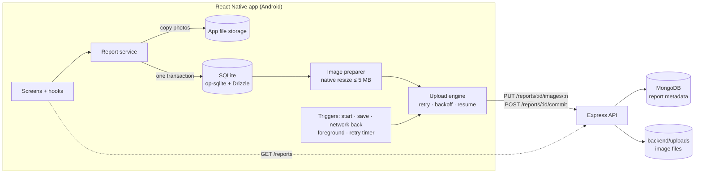

<div align="center">


# WYXAN Field Report

**An offline-first React Native app that gets every field report to the server, whatever the network is doing.**


</div>

A field inspector writes a short description, adds 1–5 photos (camera or
gallery) and taps **Save**. The report is stored on the phone immediately,
its photos are compressed under 5 MB, and it uploads on its own: on 2G, after
dropped connections, after a force-quit. Retries never create duplicates. A
second tab shows what the **server** actually holds.

Built with the **React Native CLI** (bare, no Expo) for the WYXAN mobile
technical assessment.

**Contents:**
[Features](#features) ·
[Demo](#demo) ·
[Architecture](#architecture) ·
[Getting started](#getting-started) ·
[Backend](#backend-setup) ·
[Running the app](#running-the-app) ·
[How it works](#how-it-works) ·
[Failure simulation](#failure-simulation) ·
[Design decisions](#reliability-and-design-decisions) ·
[Testing](#testing) ·
[Limitations](#known-limitations)

---

## Features

- **Compose:** a required description (whitespace-only is rejected, max 500
  characters) and **1–5 photos** from the camera or gallery. 0 and 6 photos
  are impossible to save.
- **Save is instant and local:** photos are copied into the app's own storage,
  and the report is written to SQLite in one transaction.
- **Photos under 5 MB:** every photo is re-encoded natively, off the JS
  thread, to a JPEG of at most 5,000,000 bytes. An 18 MB original is valid
  input.
- **Unattended delivery:** an upload engine sends photo by photo, then
  commits, with retries, exponential backoff and stall timeouts.
- **Survives everything local:** force-quit, dropped connection, lost
  response. Every step is persisted, so work resumes from the exact step.
- **No duplicates:** the report id is a UUID made on the phone and is the
  server's primary key, so repeated requests are idempotent.
- **Connectivity-aware:** uploads resume when the network comes back or the
  app returns to the foreground. NetInfo is only a cue, never a gate.
- **Honest UI:** "Saved on phone" and "Uploaded to server" are different
  states with their own colour and icon, plus a live network indicator and
  per-photo status.
- **Server review:** the _On server_ tab lists what the server returns, with
  loading, empty, error and offline states.
- **Start over:** a deliberate reset of everything on the phone. It never
  touches the server.
- **Camera permission:** a denied, then allowed-in-Settings permission is
  picked up without restarting the app.

## Demo

[Demo Video](YOUR_DEMO_VIDEO_URL)

## Architecture



| Layer    | Responsibility                                                                                                  | Where                                        |
| -------- | --------------------------------------------------------------------------------------------------------------- | -------------------------------------------- |
| UI       | Screens, components and thin hooks; no business logic                                                           | `src/screens`, `src/components`, `src/hooks` |
| Services | Saving, compression, upload engine, triggers; plain TypeScript, no React, unit tested                           | `src/services`                               |
| SQLite   | Reports, photos and upload/retry state (the persistent queue)                                                   | `src/db`                                     |
| Network  | `fetch` for JSON, `XMLHttpRequest` for photo uploads (byte progress); every call returns a result, never throws | `src/services/api`                           |
| Backend  | Image upload, commit, list; validation and idempotency                                                          | `backend/src`                                |
| MongoDB  | Committed reports (metadata and image paths); the images themselves are files in `backend/uploads/`             | `backend/src/store`                          |

The screens never talk to the database or the API directly. All the wiring
lives in one composition root, `src/services/index.ts`.

## Getting started

### Prerequisites

| Tool                     | Notes                                                                                                  |
| ------------------------ | ------------------------------------------------------------------------------------------------------ |
| **Node.js**              | `>= 22.18` for the backend (it runs TypeScript directly via type stripping). Developed on **Node 24**. |
| **npm**                  | Both packages use `package-lock.json`.                                                                 |
| **Android Studio + SDK** | minSdk 24, targetSdk 36. A physical device or an emulator.                                             |
| **JDK**                  | A JDK supported by React Native 0.88 (developed with **JDK 21**).                                      |
| **MongoDB**              | Local (e.g. `brew install mongodb-community`) or a MongoDB Atlas cluster.                              |
| Xcode + CocoaPods        | iOS only, optional ([see below](#ios-partly-verified)).                                                |

Follow the official [React Native environment setup](https://reactnative.dev/docs/set-up-your-environment)
for the Android toolchain.

### Clone and install

```bash
git clone https://github.com/Aqib-dev-stack/WyxanFieldReport.git
```

```bash
cd WyxanFieldReport
```

```bash
npm install
```

```bash
cd backend && npm install
```

## Backend setup

The backend is a separate Node package in [`backend/`](backend/README.md):
Express 5 and MongoDB (Mongoose), with images stored on disk.

**1. Create `backend/.env`** from the template. It is git-ignored; never
commit credentials.

```bash
cd backend && cp .env.example .env
```

| Variable        | Default                           | Meaning                                                  |
| --------------- | --------------------------------- | -------------------------------------------------------- |
| `PORT`          | `4000`                            | Port the API listens on (all network interfaces)         |
| `MONGODB_URI`   | `mongodb://localhost:27017/wyxan` | Local MongoDB, or an Atlas `mongodb+srv://…` string      |
| `UPLOAD_DIR`    | `./uploads`                       | Where image files are stored                             |
| `ENABLE_ADMIN`  | `true`                            | Enables `/admin/chaos` and `/admin/reset` (testing only) |
| `SLOW_DELAY_MS` | `8000`                            | Delay used by the `slow` chaos mode                      |

**2. Start MongoDB** if it runs locally:

```bash
brew services start mongodb-community
```

**3. Start the API:**

```bash
npm run dev
```

`npm run dev` restarts on file changes; `npm start` runs it once. On startup
it prints the database host, with the password masked. Stop it with
<kbd>Ctrl</kbd>+<kbd>C</kbd>.

**4. Check it is up:**

```bash
curl http://localhost:4000/health
```

The answer should be `{"ok":true}`.

## Running the app

### Point the app at the backend

**No frontend `.env` file is required.** The backend address is one
constant in [`src/config/api.ts`](src/config/api.ts):

```ts
export const API_BASE_URL = 'http://192.168.1.23:4000';
```

Set it to the address at which **the phone** can reach the computer running
the backend. `localhost` on a physical phone is the phone itself.

| Target                                            | `API_BASE_URL`                                                        |
| ------------------------------------------------- | --------------------------------------------------------------------- |
| Android physical device, same Wi-Fi (recommended) | `http://<computer's LAN IP>:4000`. On macOS: `ipconfig getifaddr en0` |
| Android emulator                                  | `http://10.0.2.2:4000` (the emulator's alias for the host computer)   |
| iOS Simulator (unverified)                        | `http://localhost:4000`                                               |
| iOS physical device (unverified)                  | `http://<computer's LAN IP>:4000`                                     |

The value is built into the app, so after changing it reload Metro (debug) or
rebuild (release).

> **Testing offline behaviour:** use the Wi-Fi setup. With a USB cable and
> `adb reverse`, the traffic goes through the cable, so airplane mode does
> not cut the app off from the server.

Plain HTTP to the local backend is allowed by
[`network_security_config.xml`](android/app/src/main/res/xml/network_security_config.xml),
including in release builds, which React Native would otherwise block.

### Android

Start Metro:

```bash
npm start
```

In a second terminal, with a device connected (`adb devices`) or an emulator
running:

```bash
npm run android
```

**Release APK** (no Metro needed; the JavaScript is bundled in):

```bash
cd android && ./gradlew assembleRelease
```

```bash
adb install -r android/app/build/outputs/apk/release/app-release.apk
```

The release build is signed with the debug keystore from the React Native
template, which is fine for testing but not for publishing.

**Permissions:** only `INTERNET` and `CAMERA`. Camera access is requested on
the first _Take photo_. The gallery uses the system photo picker, which needs
no storage permission.

### iOS (partly verified)

Android is the required platform. The iOS app **builds and launches on the
iOS Simulator** (Xcode 27), but the full compose → upload flow was only
tested on Android.

CocoaPods needs a UTF-8 terminal, so set the locale first:

```bash
export LANG=en_US.UTF-8
```

Then install the gems and pods, and run:

```bash
bundle install
```

```bash
cd ios && bundle exec pod install && cd ..
```

```bash
npm run ios
```

## How it works

1. **Compose:** description plus 1–5 photos. The Save button stays disabled
   until the report is valid.
2. **Save:** photos are copied into the app's private storage, then the
   report and its photo rows are written to SQLite in one transaction. This
   is instant; nothing waits for the network.
3. **Prepare:** each photo is compressed under 5 MB, and the result is
   written to the database. No network is needed for this step.
4. **Upload:** each photo is sent (`PUT`), then the report is committed
   (`POST`). Every step is persisted before the next one starts.
5. **Retry:** temporary failures wait out an exponential backoff, and are
   cut short when the network comes back or the app is reopened.
6. **Confirmed:** only when the server acknowledges the commit does the
   report show **Uploaded to server**. The _On server_ tab is fetched from the
   server, never from local state.

| Status        | Shown as                                        |
| ------------- | ----------------------------------------------- |
| `queued`      | Saved on phone · waiting to upload              |
| `waitingNet`  | Saved on phone · waiting for network            |
| `compressing` | Preparing photos…                               |
| `uploading`   | Uploading 3 of 5 photos (with a progress bar)   |
| `committing`  | Finishing upload…                               |
| `uploaded`    | Uploaded to server                              |
| `failed`      | Upload failed, with the reason (needs the user) |

**Start over** (Settings) deletes every local report in any status, the
app's photo copies and the picker's temporary files. Reports on the server
and photos in the phone's gallery are kept. Uploads in progress are stopped
first.

## Failure simulation

The backend can be told to misbehave. These modes apply to `/reports` only,
not to `/health`, `/uploads` or `/admin`. `times` limits a mode to the next N
requests; without it, the mode stays on until changed.

```bash
# Drop the connection on the next 2 requests (e.g. mid-upload)
curl -X POST localhost:4000/admin/chaos -H 'Content-Type: application/json' -d '{"mode":"drop","times":2}'
```

```bash
# Back to normal
curl -X POST localhost:4000/admin/chaos -H 'Content-Type: application/json' -d '{"mode":"ok"}'
```

| Mode           | Server behaviour                                               | Expected app behaviour                                                      |
| -------------- | -------------------------------------------------------------- | --------------------------------------------------------------------------- |
| `slow`         | Waits `SLOW_DELAY_MS` before answering                         | Keeps going                                                                 |
| `drop`         | Closes the connection; nothing saved                           | Retries                                                                     |
| `lostResponse` | Does the work, then closes the connection instead of answering | Retries; still one report on the server                                     |
| `error500`     | Answers 500                                                    | Retries with backoff                                                        |
| `reject413`    | Answers 413 to image uploads                                   | Marks the report failed; no retry                                           |
| `hang`         | Never answers                                                  | Times out (uploads: 45 s without progress; other calls: 30 s), then retries |

**Other checks:**

- current mode: `curl localhost:4000/admin/chaos`;
- wipe the server: `curl -X POST localhost:4000/admin/reset`;
- no network at all: airplane mode on the phone, or stop the backend.

## Reliability and design decisions

The phone is the source of truth until the server confirms. A report exists
in SQLite before anything is sent. Every state change (photo compressed,
photo uploaded, committing, uploaded) is written before the next step
starts, so a force-quit or crash resumes from that step. Delivery is retried
until the server acknowledges. Server-side idempotency then ensures that
however many times a request is repeated, **one copy** of the report is
stored.

- **Idempotency:** the report UUID is generated on the phone (secure random)
  and is MongoDB's `_id`. Images are addressed by report id and slot
  (re-sending overwrites), and commit returns the stored report on repeats.
- **Retry policy, in one place:** no connection, timeouts, 5xx, 408 and 429
  are retried. 413 and other 4xx are final and shown to the user.
  - Backoff: 2 s doubling up to 5 min, with full jitter.
  - A report that keeps failing cannot starve newer ones.
- **Slow networks:** uploads have **no total time limit**. They are cut only
  when no bytes move for 45 s (a stall timer, re-armed on every progress
  event), so a slow 2G upload keeps going.
- **5 MB limit:** photos are compressed by
  `@bam.tech/react-native-image-resizer` on a native thread.
  - Quality drops before resolution does; metadata such as GPS is removed.
  - The size is checked again right before upload.
  - The server rejects anything over 5,000,000 bytes.
- **Integrity:** each photo is sent with its SHA-256, and the server refuses
  a damaged image.
- **One SQLite connection, one queue:** every statement goes through a
  serial queue, so a transaction can never pick up another caller's
  statement.
  - Drizzle runs on its `sqlite-proxy` driver over op-sqlite: Drizzle's
    built-in op-sqlite driver does not match op-sqlite 19's API.

More detail: [`backend/README.md`](backend/README.md) for the API, and the
doc comments in `src/services`.

## Testing

```bash
npm test
```

```bash
cd backend && npm test
```

```bash
npm run typecheck && npm run lint
```

- **App (Jest):**
  - the upload engine against a fake server with the backend's rules
    (dropped connections, lost responses, 500, 413, force-quit resume,
    size guard, pause, fairness);
  - compression, triggers, the report service and validation;
  - the database repository on a real in-memory SQLite (Node's `node:sqlite`,
    so Node 22.16+);
  - a smoke test that opens every screen and fails on any console warning.
- **Backend (`node --test` + supertest):** idempotency, the 5 MB limit,
  missing-image commits, ordering and every chaos mode.

To inspect the phone's database during development (debug builds), run the
command below, then `sqlite3 .local-db/wyxan.db '.tables'`:

```bash
npm run db:pull
```

## Project structure

```
src/
  screens/      Outbox, Compose, ReportDetail, ServerReports, Settings
  components/   UI building blocks (brand, common, layout, report)
  hooks/        Thin adapters between screens and services
  services/     reports · images · upload · triggers · api · files (+ index.ts wiring)
  db/           Drizzle schema, migrations, repository, SQLite client
  config/       Theme, limits, API settings
  types/ utils/ Domain types and pure helpers
backend/        Express + MongoDB API, chaos modes, tests
__tests__/      Jest tests
```

## Known limitations

- **Background execution:**
  - Uploads continue while Android lets the app run, and resume on the next
    start, foreground or network change.
  - There is no foreground service or WorkManager job, so a phone left in a
    pocket for hours will not upload until the app is opened again.
  - Nothing is lost meanwhile.
- **iOS** builds and launches on the Simulator, but the upload flow was only
  tested on Android.
- **Local backend over plain HTTP:**
  - The server address is a build-time constant, so a new IP means a reload
    or rebuild.
  - Cleartext HTTP is enabled for this demo setup.
- **Admin and chaos endpoints are unauthenticated** (on by default via
  `ENABLE_ADMIN=true`). They are meant for local testing only.
- **Server images live on the backend's local disk**, not in object
  storage.
- **Original photos stay on the phone** after upload, until _Start over_.
- **Unsaved drafts are not persisted:** force-quitting the Compose screen
  before saving loses that draft. Saved reports are never lost.

## With another day

- An Android foreground service or WorkManager job, so uploads finish
  without opening the app.
- Delete local photo files once the server has confirmed a report, to free
  storage.
- Automated end-to-end runs on a real device with a throttled, flapping
  network (e.g. Maestro).
- HTTPS, a configurable server address, and authentication on the admin
  endpoints.
- Test the full flow on iOS (Simulator and a physical iPhone).
